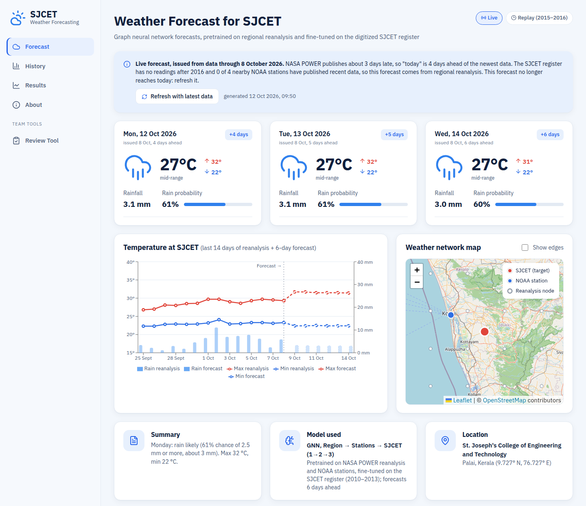
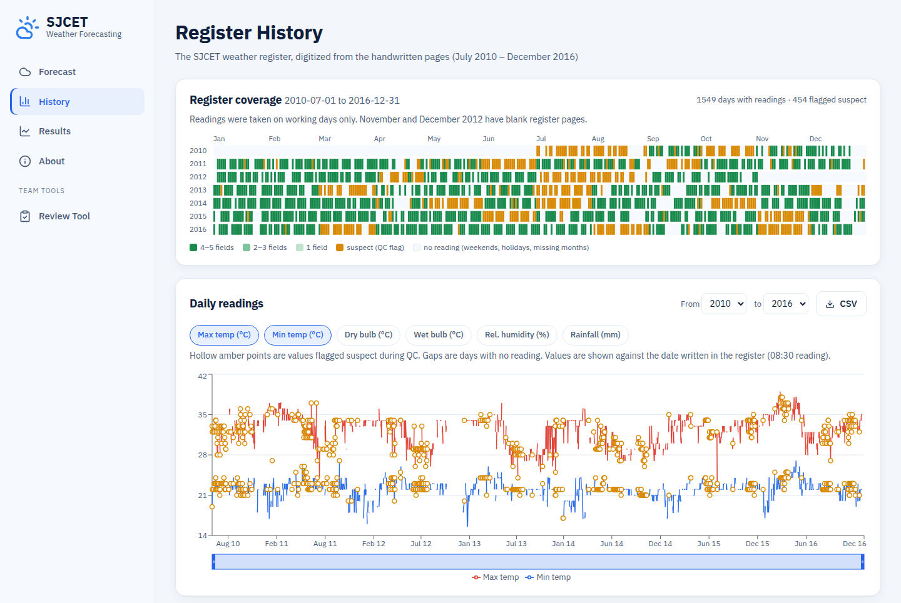
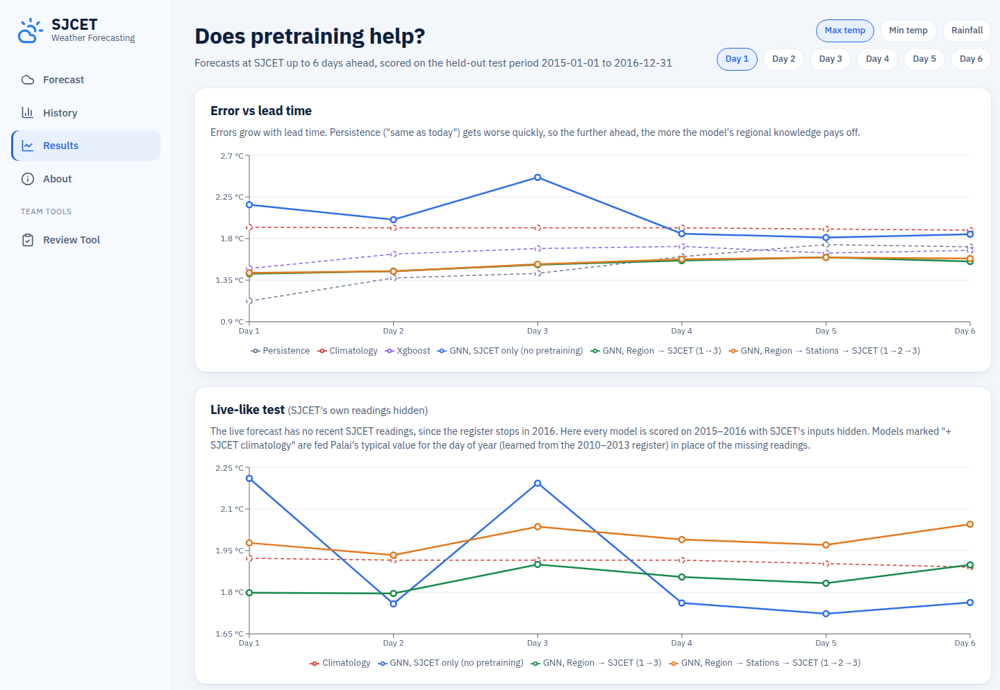

# Transfer Learning-Based Weather Forecasting for SJCET

Final-year B.Tech project (Phase 1), Department of Artificial Intelligence and Data Science,
St. Joseph's College of Engineering and Technology (SJCET), Palai, Kerala.

The college has kept a paper weather register (dry/wet bulb, max/min temperature, rainfall) for years,
but it was never digitized, and a few years of readings from one station are far too little to
train a forecasting model on. This project does two things:

1. **Digitizes the register.** The July 2010 – December 2016 scans were transcribed cell by cell,
   checked automatically and against the written monthly rainfall totals, and assembled into
   `data/sjcet/sjcet_daily.csv`.
2. **Forecasts SJCET weather 6 days ahead with staged transfer learning.** A graph neural network
   is pretrained on 36 years of regional reanalysis over India (stage 1), then on NOAA stations
   in and around Kerala (stage 2), and finally fine-tuned on the small SJCET record (stage 3).

A web app shows the live forecast, the digitized register, and how the models compare.

## Results at a glance

SJCET test period 2015–2016, all SJCET training months, forecasts issued one day ahead
(full tables in [model/README.md](model/README.md) and chapter 4 of the [report](Report/thesis.pdf)):

| Model | Tmax accuracy | Tmin accuracy | Tmax RMSE | Tmin RMSE |
|---|---|---|---|---|
| **GNN, region → stations → SJCET** (default) | **96.6%** | **96.2%** | 1.43 °C | 1.08 °C |
| GNN, region → SJCET | 96.7% | 96.1% | 1.42 °C | 1.10 °C |
| GNN, SJCET only (no pretraining) | 94.9% | 94.1% | 2.17 °C | 1.72 °C |
| XGBoost (station + nearest grid) | 96.6% | 96.4% | 1.48 °C | 1.04 °C |
| Climatology | 95.3% | 95.7% | 1.92 °C | 1.24 °C |

Accuracy is 100 − MAPE. With the default model, 86% of next-day maximum and 93% of minimum
temperature forecasts fall within ±2 °C of the register reading. Pretraining cuts the error by about
a third compared with the same network trained on SJCET alone, and the gap is largest when SJCET
data is scarce: with 10% of its training months, pretrained models reach a Tmin RMSE of 2.1–2.5 °C,
against 3.7 °C from scratch.

## Screenshots

| Forecast | History | Results |
|---|---|---|
|  |  |  |

## Project report

The Phase 1 report (LaTeX source and PDF) is in [Report/](Report/): **[Report/thesis.pdf](Report/thesis.pdf)**.

## Team

C S Vaishakh (SJC23AD025) · Elisha Anto (SJC23AD032) · Jeffin James (SJC23AD037) · Rahul Sarang (SJC23AD061)

Guide: Ms. Neethu Tom, Assistant Professor, Department of Artificial Intelligence and Data Science, SJCET Palai.

---

## Repository layout

```
.
├── start.sh            # one command to start the web app (API + frontend)
├── digitization/       # turning the paper register into data/sjcet/sjcet_daily.csv
├── model/              # data download, graph building, staged GNN training, forecasts
├── frontend/
│   ├── api/            # FastAPI backend: serves the files the other parts produce
│   └── web/            # React + Vite + TypeScript web app
├── Report/            # Phase 1 report: LaTeX source, figures, thesis.pdf
├── data/sjcet/         # the digitized register (not in git)
├── Dataset/            # NOAA GSOD daily files 1929–2025 (not in git)
└── About/              # scans, photos, review slides, papers (not in git)
```

Each part has its own README:

| Part | README | Python env |
|---|---|---|
| Digitization | [digitization/NOTES.md](digitization/NOTES.md) | `digitization/` (uv) |
| Model | [model/README.md](model/README.md) | `model/` (uv, PyTorch CPU) |
| Web app | [frontend/README.md](frontend/README.md) | `frontend/api/` (uv) + Node for `frontend/web/` |
| Report | [Report/README.md](Report/README.md) | LaTeX (`latexmk`) |

Datasets, model outputs and checkpoints are kept out of git (see [.gitignore](.gitignore)).
To run the app on a fresh clone, copy `data/sjcet/` and `model/outputs/` over from a machine that
has them, or rebuild them (see [Rebuilding everything](#rebuilding-everything-from-scratch)).

---

## Starting the app

### Requirements

- Linux or WSL2 (the scripts are bash)
- [uv](https://docs.astral.sh/uv/) for Python 3.11/3.12:
  `curl -LsSf https://astral.sh/uv/install.sh | sh`
- Node.js 18+ and npm
- Internet access only for the live forecast refresh

### One command

From the repository root:

```bash
./start.sh            # start the API (port 8000) and the web app (port 5173)
./start.sh --refresh  # also fetch the latest data and remake today's live forecast first (~1 min)
```

The script installs whatever is missing, starts both servers, waits for them to respond and
opens **http://localhost:5173** in your browser (on WSL, in the Windows browser).
The first run takes a few minutes to install dependencies; after that it starts in about 10 seconds.

Press **Ctrl+C** in the same terminal to stop both servers.
Server logs are written to `.start-logs/api.log` and `.start-logs/web.log`.

At startup the script warns about anything the app cannot find:

| Warning | Effect | Fix |
|---|---|---|
| `sjcet_daily.csv missing` | History page is empty | `cd digitization && uv run python assemble.py` |
| `metrics.json missing` | Results page is empty | `cd model && ./run_all.sh` |
| `replay forecasts missing` | Replay mode is empty | `cd model && uv run python predict.py --export` |
| `no live forecast yet` | Live mode offers a "Make one now" button | `./start.sh --refresh` |

### Starting the servers by hand

If you want to run them separately (for example to see the logs), use two terminals:

```bash
# terminal 1: API on http://localhost:8000 (docs at /docs)
cd frontend/api && uv sync && uv run uvicorn main:app --reload --port 8000

# terminal 2: web app on http://localhost:5173 (forwards /api to port 8000)
cd frontend/web && npm install && npm run dev
```

The app only **shows** results that are already on disk. It never trains a model. The one
exception is the live-forecast refresh, which runs `model/live.py` on request.

---

## Using the app

The sidebar has four pages plus a team tool. The **Dark mode / Light mode** button at the
bottom of the sidebar switches the theme.

### Forecast

The page opens here. Use the **Live / Replay** switch at the top to choose a mode.

**Live** (default): the forecast made from the newest data available.
- Three cards show **today, tomorrow and the day after**: max/min temperature, rainfall,
  chance of rain and relative humidity.
- The note at the top says which day the forecast was issued from. NASA POWER publishes about
  3 days late, so the model forecasts 6 days ahead from the newest complete day and today is
  usually lead day 4.
- Click **Refresh with latest data** to download the newest data and rerun the model
  (about 1–2 minutes, needs internet). If no live forecast exists yet, click **Make one now**.
- The chart shows the last 14 days of reanalysis at SJCET followed by the 6-day forecast.

**Replay**: forecasts for past dates, compared with what the register actually recorded.
- Pick a date in **Forecast issued on** (test period 2015–2016) and a **Model**
  (default: the GNN pretrained on region → stations → SJCET).
- The cards show the forecast with the observed values next to it.
- The chart compares forecast and observed temperature around that date.

Both modes show the **weather network map**: the reanalysis grid, NOAA stations and SJCET that the
graph model is built on. Tick **Show edges** to draw the graph connections.

### History

The digitized register.
- **Register coverage:** one row per year, one cell per day. Gaps are days with no reading
  (mostly weekends and holidays). Hover a cell for its date and quality flag.
- **Daily readings:** choose the years with **From** / **to** and toggle the variables
  (max/min temperature, dry/wet bulb, humidity, rainfall). Hollow dots are values flagged
  as suspect during checking. **CSV** downloads the selected years.
- **Monthly rainfall**, **Annual means** and **Annual rainfall** summarise the record.

### Results

"Does pretraining help?": how well each model forecasts SJCET over the held-out test period.
- At the top right, choose the **variable** (max temp, min temp, rainfall) and the
  **lead day** (1–6). The charts below follow these choices.
- **Error vs lead time:** how the error grows from day 1 to day 6, for each model and baseline.
- **Live-like test:** the same comparison with SJCET's own readings hidden, as in the live
  forecast (the register stops in 2016).
- **Error vs amount of SJCET data:** error when stage 3 sees 10%, 25%, 50% or 100% of the SJCET
  training months. This is the main transfer-learning experiment.
- **All models:** table of RMSE, bias and rain/no-rain accuracy; the best value per column is green.
  Hover a column header for what the metric means.
- **Forecast vs observed:** scatter plot and time series for the model chosen in the drop-down.
- **Error by season:** day-1 error per season.

### About

The pipeline from paper register to forecast, and the data sources used.

### Review Tool (team tool)

Meant for checking OCR'd register cells against their images. It shows an empty state for now:
the 2010–2016 register was transcribed by hand, so there are no OCR'd cells (`cells.csv`) yet.

---

## Rebuilding everything from scratch

Only needed if `data/sjcet/` or `model/outputs/` is missing or you change the data or model.
Run the steps in order:

```bash
# 1. Digitized register -> data/sjcet/sjcet_daily.csv  (needs the transcripts in digitization/work/)
cd digitization
uv sync
uv run python check_transcripts.py
uv run python assemble.py

# 2. Reanalysis data, graph, training, exports -> model/outputs/  (several hours on CPU)
cd ../model
uv sync
uv run python data/download_power.py   # ~1 h, resumable
./run_all.sh                           # resumable; SEEDS="0" ./run_all.sh is quicker
uv run python live.py                  # today's live forecast

# 3. Start the app
cd .. && ./start.sh
```

---

## Data sources

| Source | What | Used for |
|---|---|---|
| SJCET weather register | Daily dry/wet bulb, max/min, rainfall, Jul 2010 – Dec 2016 (digitized) | Stage-3 target, History page |
| [NASA POWER](https://power.larc.nasa.gov/) | Daily MERRA-2 based reanalysis 1990–2025, 1° over India, 0.5° over Kerala | Stage-1 pretraining, live inputs |
| [NOAA GSOD](https://www.ncei.noaa.gov/access/metadata/landing-page/bin/iso?id=gov.noaa.ncdc:C00516) | Daily station summaries: Bangalore, Coimbatore, Mangalore, Thiruvananthapuram, Kozhikode, Cochin | Stage-2 pretraining, live inputs |

ERA5 was the original plan, but the Copernicus queue was too slow. `model/data/download_era5.py`
is kept in case it is needed later.

---

## Status and limitations

- **Phone photos from 2017 onwards are not transcribed yet**, so the register (and the model's
  SJCET training data) ends in December 2016. The live forecast relies on regional data only.
- **OCR is not in use.** Zero-shot TrOCR read only about 33% of cells exactly, and there was no
  GPU to fine-tune it. The hand transcriptions can serve as training labels later.
- **Persistence is hard to beat on temperature.** The register stores whole degrees and the max
  thermometer often repeats for weeks, so "tomorrow = today" scores well on day 1. The models
  pull ahead at longer lead times.
- **Humidity at SJCET is approximate.** It is derived from the forecast mean temperature and
  dewpoint, and the register has no true daily mean temperature.
